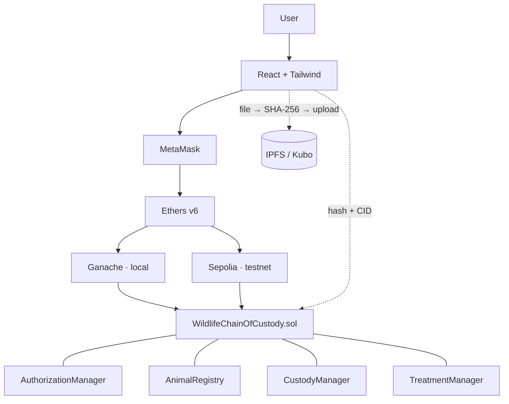

# 🐾 Wild Chain — Wildlife Rescue Chain-of-Custody

A blockchain-based system that gives every rescued animal **one verifiable digital identity and a complete, tamper-resistant custody history** — from rescue, through treatment and rehabilitation, to authorized release.

Stack: Solidity 0.8.24 · Hardhat · Ganache (local) / Ethereum Sepolia · MetaMask · Ethers v6 · React + Vite + Tailwind · IPFS (Kubo).

## Problem

Rescued animals move between rescue teams, veterinary hospitals, rehabilitation centres, forest departments and conservation organizations. Records are fragmented, custody is hard to verify, transfers can be unauthorized, and there is no unified audit trail.

## Solution overview

- Smart contracts enforce **who may act**, **who may receive custody**, and **which lifecycle step comes next**.
- Custody moves only through a **two-party handshake**: the current custodian requests, the receiving organization accepts.
- Photos and reports live on **IPFS**; only their **SHA-256 hash + CID** go on-chain. Anyone can later re-hash a file and see **MATCH** (valid) or **MISMATCH** (modified).
- An append-only **timeline** records every state change.

## Architecture



The four modules are abstract contracts composed by inheritance (`AuthorizationManager → AnimalRegistry → CustodyManager → TreatmentManager → WildlifeChainOfCustody`) so there is **one address and one ABI**.

### Lifecycle (strict, forward-only)

```
RESCUED → TRIAGED → UNDER_TREATMENT → RECOVERING → REHABILITATION → RELEASE_READY → RELEASED
```
Skipping or going backwards reverts. `RELEASED` is terminal and reachable only through `releaseAnimal`.

### Two-party transfer

```
Custodian ──requestTransfer──▶ contract (checks sender, recipient, transfer matrix, no pending)
                                   │  pendingTransferTo = recipient
Recipient ──acceptTransfer───▶ contract ──▶ custody updated + history entry
   (or rejectTransfer / custodian cancelTransfer → nothing changes)
```

### What is stored where

| Data | On-chain | IPFS |
|---|---|---|
| Animal ID, species, status, custodians | ✅ | |
| Custody history, milestones, timeline, release authorization | ✅ | |
| Timestamps | ✅ | |
| Photos, medical reports, permits | hash + CID only | ✅ file |
| Personal data | never | never |

## Roles & permissions

| Action | Who |
|---|---|
| Register / (de)activate organizations, edit transfer matrix | Contract owner |
| `registerAnimal` | Rescue Team, Forest Department |
| `requestTransfer`, `cancelTransfer` | Current custodian |
| `acceptTransfer`, `rejectTransfer` | Pending recipient |
| `recordMilestone` ASSESSMENT | Custodian that is a Vet or Rescue Team |
| `recordMilestone` TREATMENT / RECOVERY | Custodian that is a Vet |
| `recordMilestone` REHABILITATION | Custodian that is a Rehab Centre |
| `verifyMilestone` | Any active org **other than the recorder** |
| `advanceStatus` | Current custodian with the role below |
| `addEvidence` | Custodian, or any active org that has ever held custody |
| `authorizeRelease` | Forest Department (custody not required) |
| `releaseAnimal` | Custodian, or the authorizing Forest Department |

### Transition preconditions

| Transition | Role | Precondition |
|---|---|---|
| RESCUED → TRIAGED | Rescue Team or Vet | ≥1 ASSESSMENT milestone |
| TRIAGED → UNDER_TREATMENT | Vet | — |
| UNDER_TREATMENT → RECOVERING | Vet | ≥1 TREATMENT milestone |
| RECOVERING → REHABILITATION | Vet or Rehab | ≥1 RECOVERY milestone |
| REHABILITATION → RELEASE_READY | Rehab | ≥1 **verified** TREATMENT and ≥1 **verified** REHABILITATION milestone |
| RELEASE_READY → RELEASED | `releaseAnimal` | Forest Department authorization exists |

No status change is possible while a transfer is pending.

### Default transfer matrix (admin-editable)

| From \ To | Rescue | Vet | Rehab | Forest | Conservation |
|---|:-:|:-:|:-:|:-:|:-:|
| **Rescue** | · | ✓ | ✓ | ✓ | · |
| **Vet** | ✓ | · | ✓ | ✓ | ✓ |
| **Rehab** | · | ✓ | · | ✓ | ✓ |
| **Forest** | ✓ | ✓ | ✓ | · | ✓ |
| **Conservation** | · | ✓ | ✓ | ✓ | · |

## Setup from zero

Prerequisites: **Node ≥ 18** (tested on 24), npm, [Ganache](https://trufflesuite.com/ganache/) (`npm i -g ganache` or the desktop app), MetaMask, and optionally [Kubo](https://docs.ipfs.tech/install/command-line/) for IPFS.

```bash
npm ci                      # contracts + tooling
npm --prefix frontend ci    # frontend
npm run compile
npm test
npm run coverage
```

### 1. Start a local chain

```bash
npm run node:ganache        # ganache CLI: port 7545, chainId 1337, deterministic accounts
```
Using the Ganache desktop app instead? Set **port 7545**, **chain ID 1337**, and use **Network ID 1337**. The seed script assumes the accounts of the *deterministic* mnemonic below **or** whatever your workspace provides (it uses the first six accounts: #0 admin, #1–#5 organizations). Fallback with no Ganache: `npm run node:hardhat` (port 8545; change the `ganache` URL in `hardhat.config.ts`).

Deterministic mnemonic used by `npm run node:ganache`:
`myth like bonus scare over problem client lizard pioneer submit female collect`

### 2. Deploy and seed

```bash
npm run deploy:ganache      # writes frontend/src/contracts/{deployment.json,WildlifeChainOfCustody.abi.json}
npm run seed                # 5 organizations + 3 animals at different stages + demo-files/
```

### 3. IPFS (optional but recommended)

```bash
ipfs init
ipfs config --json API.HTTPHeaders.Access-Control-Allow-Origin '["http://localhost:5173","http://127.0.0.1:5173"]'
ipfs config --json API.HTTPHeaders.Access-Control-Allow-Methods '["GET","POST","PUT"]'
ipfs daemon                 # API :5001, gateway :8080
```
Without a daemon set `VITE_STORAGE=memory` in `frontend/.env` (files then live only in the current tab). Re-run the seed against a running daemon to get real CIDs; otherwise it stores clearly-labelled `offline-demo-…` placeholders (hash verification works either way).

### 4. Run the app

```bash
cp frontend/.env.example frontend/.env   # once
npm run dev                               # http://localhost:5173
```

### 5. MetaMask

1. *Add network manually*: RPC `http://127.0.0.1:7545`, chain ID `1337`, symbol `ETH` (the app can also add it for you via the wrong-network banner).
2. *Import accounts* using the private keys Ganache prints (`ganache` output / desktop app key icon). Import #0 (admin) and the five organization accounts. Switching accounts in MetaMask updates the UI instantly.

| Ganache account | Role (after `npm run seed`) |
|---|---|
| #0 | Contract owner / admin |
| #1 | Coastal Rescue Team |
| #2 | City Veterinary Hospital |
| #3 | Green Valley Rehabilitation Centre |
| #4 | State Forest Department |
| #5 | Wildlife Conservation Trust |

### Sepolia

```bash
cp .env.example .env        # fill SEPOLIA_RPC_URL and a TESTNET-ONLY DEPLOYER_PRIVATE_KEY
npm run deploy:sepolia
```
The UI then works on Sepolia (chain 11155111) and links transactions to Etherscan. The `.env` file is git-ignored.

## Demo script

After seeding (open the app as each wallet):

- **#3 Bengal Tiger** (RESCUED, transfer pending): as *City Vet* open **Transfers → Accept**. Custody updates only now.
- **#2 Golden Eagle** (RECOVERING at the vet): as *Vet* record a RECOVERY milestone → transfer to *Rehab* (request → *Rehab* accepts) → *Rehab* advances to REHABILITATION, records a REHABILITATION milestone → *Forest* / *Conservation* verify milestones → *Rehab* advances to RELEASE_READY → *Forest* authorizes release → *Rehab* releases.
- **#1 Spotted Deer** (RELEASED): browse the full custody history, verified milestones and 18-event timeline.
- **Verify evidence** on #1: upload `demo-files/deer-medical-report.txt` → **MATCH**; upload `deer-medical-report-MODIFIED.txt` → **MISMATCH**. Or use *Fetch from IPFS by CID*.
- **Admin** (as #0): register an organization, deactivate one, flip a transfer-matrix cell.

## Tests & coverage

`npm test` → 39 tests. `npm run coverage` (solidity-coverage):

| File | Stmts | Branch | Funcs | Lines |
|---|---|---|---|---|
| AnimalRegistry | 96.88% | 97.5% | 92.86% | 97.44% |
| AuthorizationManager | 100% | 100% | 100% | 100% |
| CustodyManager | 100% | 97.5% | 100% | 100% |
| TreatmentManager | 100% | 98.33% | 100% | 100% |
| WildlifeChainOfCustody | 100% | 100% | 100% | 100% |
| **All contracts** | **99.48%** | **98.26%** | **97.87%** | **99.56%** |

(The one uncovered line is the internal `_evidenceLength` helper.)

## Expected outcomes → tests → UI

| Outcome | Test(s) (`test/wildlife.test.ts`) | UI |
|---|---|---|
| Registration of rescued animals | "registers an animal with custodian, RESCUED status, evidence and timeline"; role/validation tests | Register Animal |
| Authorized custody transfers | "request -> accept updates custody only on accept"; "cancel and reject…"; "rejects invalid requests"; "wrong acceptor/rejector reverts…" | Transfers |
| Lifecycle tracking | "happy path: full journey…"; "every invalid transition reverts"; "cannot go backwards, skip…" | Animal Detail (stepper) |
| Treatment & rehabilitation milestones | "records a milestone…"; "verification: different org only…"; "enforces milestone preconditions…" | Record, Animal Detail |
| Release authorization | "only an active ForestDepartment authorizes…"; "release requires authorization…" | Release |
| Evidence verification (MATCH/MISMATCH) | "adds, finds and detects modified files" | Verify Evidence |
| Tamper-resistant custody history | "happy path…" (history + timeline assertions) | Animal Detail (history + timeline) |

## Frontend

Pages: Dashboard · Register Animal · Animal Detail (stepper, custody history, milestones with verify, evidence, timeline) · Transfers · Milestones & Evidence · Release · Verify Evidence · Admin.
Buttons are disabled with an explanatory tooltip unless the connected wallet's role, custody, status and preconditions allow the action. Custom contract errors are decoded into readable messages; transactions show pending/confirmed/failed toasts (with Etherscan links on Sepolia).

IPFS layer: `frontend/src/lib/storage/` exposes `EvidenceStore { upload(file); fetch(cid) }` with `KuboStore` and `MemoryStore`, chosen by `VITE_STORAGE`. **No API secrets belong in frontend code.** To use Pinata or web3.storage, add a small backend proxy that holds the key and accepts uploads from the app, then implement a `ProxyStore` with the same interface.

SHA-256 is computed with `crypto.subtle` over the raw file bytes, so it equals `sha256sum file`.

## Limitations

- **Anything on public IPFS is public.** Do not upload sensitive material unless it is encrypted first (client-side encryption is a stretch goal and is **not implemented**).
- **Organizations are registered by a trusted admin** (the contract owner). The contract cannot tell whether a registered organization is honest.
- **Prototype, not audited.**
- The on-chain timeline and evidence lists cost gas that grows with each record; read views iterate over arrays (`verifyEvidenceHash`) and are meant for off-chain calls.
- A deactivated custodian cannot act until an admin reactivates it (there is no admin override of custody, by design).
- The frontend was verified against Ganache with a scripted mock wallet; MetaMask itself and Sepolia were not exercised end to end.

## Docs

- [`docs/DECISIONS.md`](docs/DECISIONS.md) — design decisions and rationale
- [`docs/MIGRATION_PLAN.md`](docs/MIGRATION_PLAN.md) — how this repo was converted from the previous project
- [`docs/blockchain_project_2.pdf`](docs/blockchain_project_2.pdf) — the written spec
